# Games Gallery

Aplicativo desktop (Tauri 2 + React 19 + TypeScript + Vite) que cataloga jogos de **PC** (Steam, GOG, Epic, Ubisoft, EA, Battle.net, Game Pass, Amazon, itch.io, Humble, Rockstar, Playnite/Heroic) e de **consoles** (PS1–PS5, PSP, Vita, Xbox → Series, NES → Switch, Sega, retrô), com capas, status (jogando / quero jogar / zerado / abandonado / wishlist) e gerenciamento de **emuladores**. A biblioteca vem dos launchers instalados no computador, não de dados de demonstração.

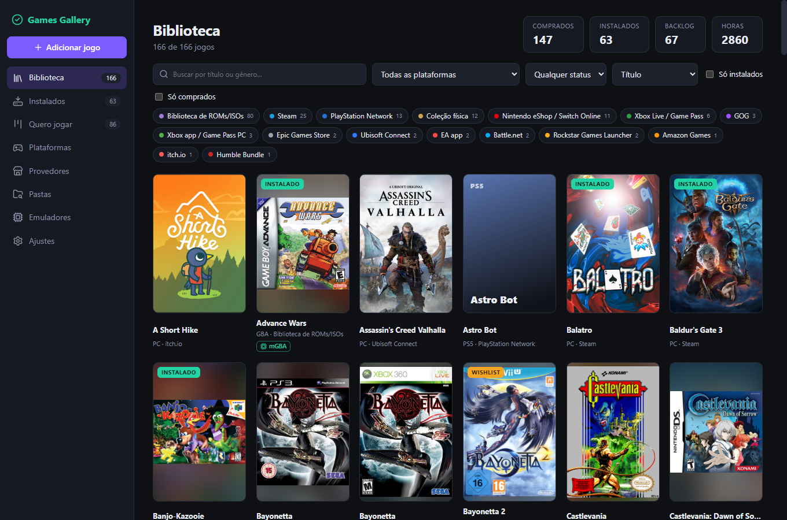

## Rodar

Requisitos: Node.js 22.12+, 24.x ou 26+; pnpm 10.34.5.

O CI valida todos os workflows do GitHub Actions com actionlint antes de instalar as dependências.

```bash
pnpm install
pnpm dev            # só a UI, em http://localhost:1420 (sem leitura local nem execução)
pnpm tauri dev      # janela nativa: detecção real, instalação e launch (requer Rust + WebView2)
pnpm test           # lógica de domínio
VITE_CHECK_COVERS=1 pnpm test   # também confere que todas as URLs de capa respondem
```

A detecção de bibliotecas, a instalação de emuladores e o botão Jogar dependem do app nativo: no navegador a UI avisa em vez de simular.

## Identidade visual ("Aurora on ink")

Superfícies quase pretas com um degradê ember → rose → orchid como assinatura e verde-aurora só para estados positivos (instalado, ok). Tipografia: Bricolage Grotesque (títulos) + Inter (texto), ambas empacotadas via `@fontsource`, sem rede em runtime.

- **Tailwind CSS v4** (`@tailwindcss/vite`, sem preflight) com tokens em `src/styles/theme.css`; os estilos antigos ficam em `@layer legacy`, abaixo das utilities, e `identity.css` remapeia as variáveis para a nova paleta, então todas as telas herdam a identidade.
- **motion** (`LazyMotion`, carregado depois do primeiro paint): indicador de navegação que desliza entre itens e entrada do destaque. Cards têm tilt 3D e brilho que segue o ponteiro (variáveis CSS, sem re-render) e contadores animados nas estatísticas; tudo respeita `prefers-reduced-motion`.
- Destaque na Biblioteca (o que você está jogando ou o mais jogado), busca com atalho `/`, logo e ícones do app regenerados (`pnpm tauri icon`).

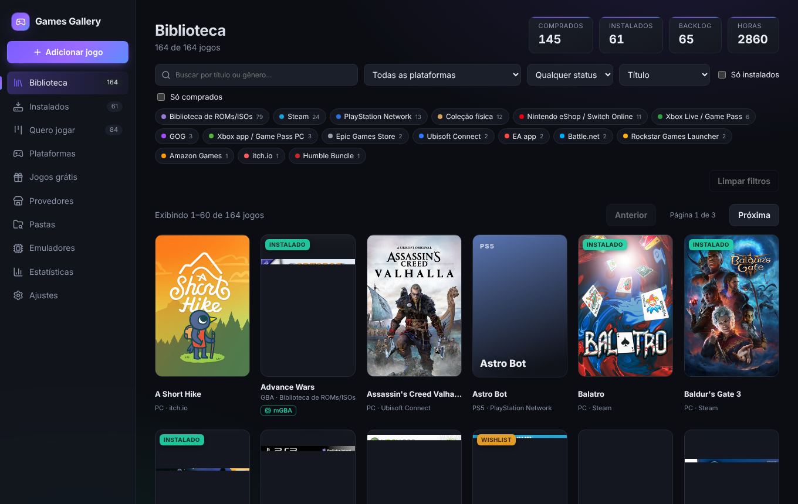
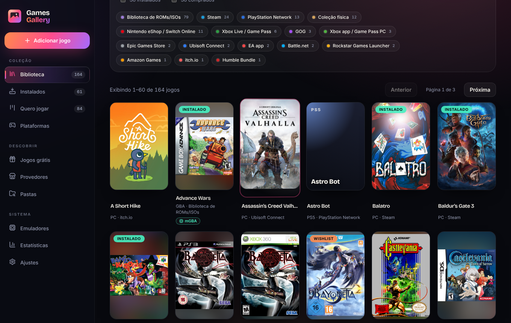

O modo **Caixas** mostra cada jogo como a embalagem de varejo da plataforma (estojo de DVD ou Blu-ray, jewel case, UMD, estojo do Switch, caixa de papelão de NES/SNES/N64, clamshell do Mega Drive…) em prateleiras 3D. Clique em uma caixa para girá-la, abrir a tampa e tirar o disco, o cartão ou o cartucho. Usa a capa da loja quando existe e uma arte gerada quando não.

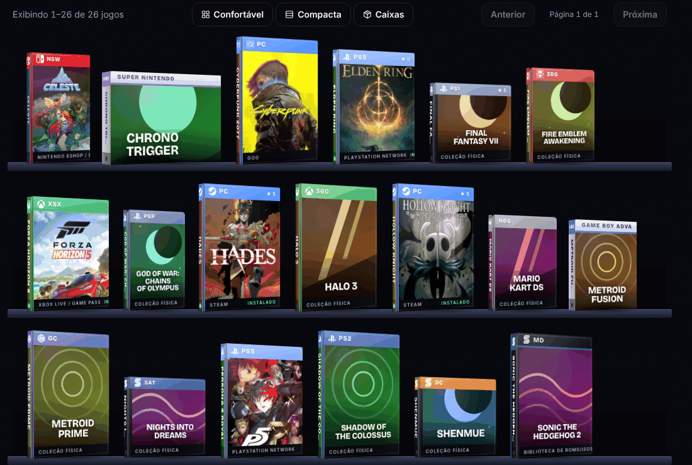

### Sidebar

- **Perfil e nível:** anel de XP em volta do nível (1 h jogada = 1 XP, jogo zerado = 20, nota dada = 2; ver `src/domain/profile.ts`), título por faixa de nível, barra de status da coleção, % zerados e GB em disco.
- **Paleta de comandos (`Ctrl`/`⌘` + `K`):** vai para qualquer tela, adiciona jogo e abre qualquer título, tudo pelo teclado (setas, Enter, Esc).
- **Jogando agora:** o jogo em andamento com atalho para abrir e "Sortear do backlog".
- **Navegação:** pílula ativa que desliza, brilho que segue o ponteiro e contadores; tarefas em andamento aparecem no rodapé.
- **Recolher:** botão no rodapé (a escolha fica salva); em janelas estreitas (≤ 860 px) vira trilho de ícones automaticamente.

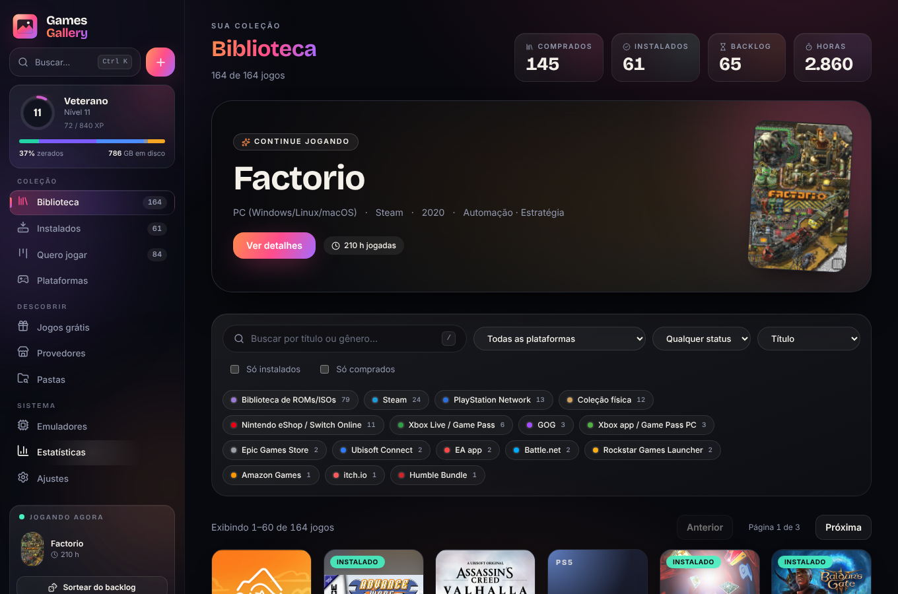
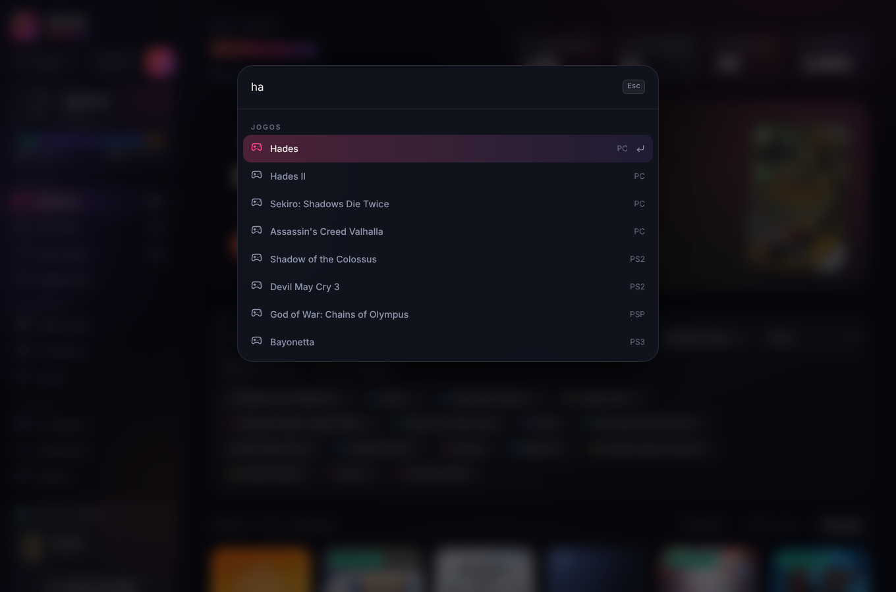

### Detalhes do jogo

Painel lateral com hero cinematográfico (arte desfocada, capa flutuante, status, horas, minha nota e média pública), três abas (**Visão geral**, **Notas**, **Jogar**; navegáveis com ← →) e barra de ação fixa no rodapé com a ação certa para o estado do jogo (comprar, instalar/preparar, jogar), desinstalar e remover com confirmação em dois cliques. Status em pílulas coloridas, estrelas com prévia ao passar o mouse e contador de horas com `−` / `+` e atalhos `+2 h`, `+5 h`, `+10 h`.

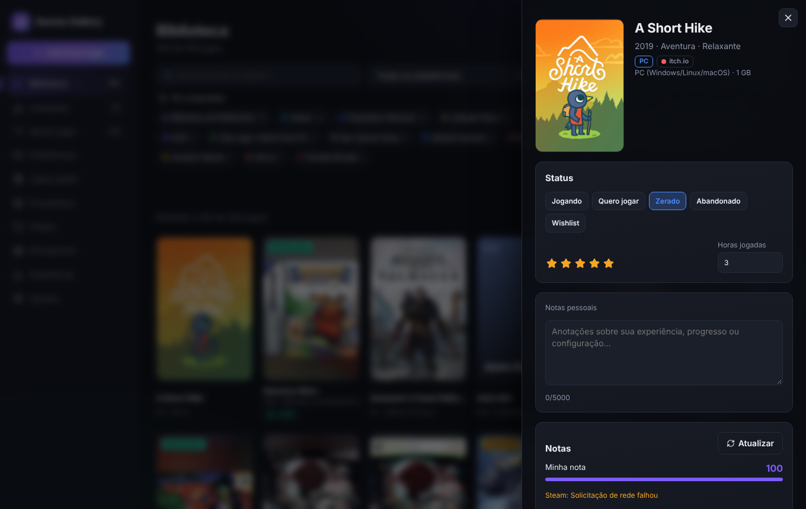
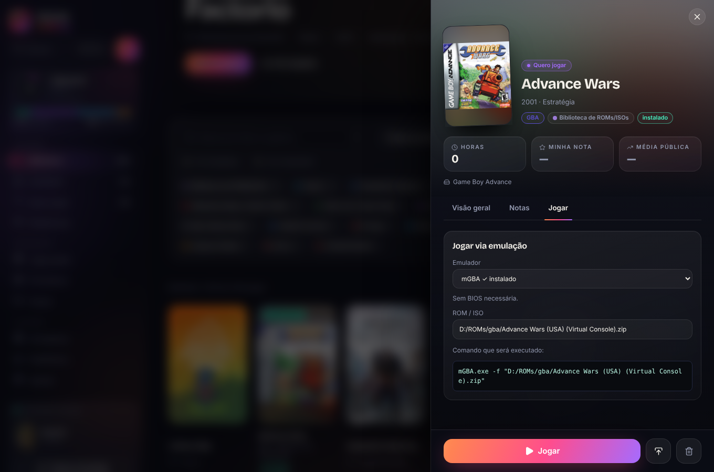

## Executáveis (Tauri 2)

O workflow `release` (`.github/workflows/release.yml`) gera os instaladores em Windows (NSIS `.exe` e `.msi`), macOS (`.dmg`, Apple Silicon e Intel) e Linux (`.deb`, `.rpm`, `.AppImage`). Em PRs que mexem no empacotamento e em execuções manuais os bundles saem como artifacts; as releases de verdade são publicadas pelo `auto-release` (próxima seção).

```bash
pnpm tauri build               # bundles do seu sistema em src-tauri/target/release/bundle
pnpm tauri build --bundles deb # exemplo: só um formato
```

## Releases e atualização automática

**Versão pelos commits.** A cada push na `main`, o workflow `auto-release` (`.github/workflows/auto-release.yml`) lê os [Conventional Commits](https://www.conventionalcommits.org/pt-br/) desde a última tag `v*`, calcula a próxima versão, gera as notas, compila os instaladores e publica a release no GitHub (a tag nasce junto). Nada é commitado de volta na `main`: a tag é a versão, e o número é gravado só no checkout do build (`scripts/release/stamp.mjs`).

| Commit | Efeito |
| --- | --- |
| `feat: ...` | sobe o minor (`1.2.0` → `1.3.0`) |
| `fix:`, `perf:`, `revert:` | sobe o patch (`1.2.0` → `1.2.1`) |
| `feat!: ...` ou rodapé `BREAKING CHANGE:` | sobe o major (`1.x` → `2.0.0`); enquanto o app é `0.x`, sobe o minor |
| `docs`, `style`, `refactor`, `test`, `build`, `ci`, `chore` | não publica nada |

- O título do PR vira a mensagem do squash merge, então o workflow `semantic-pr` confere que ele segue o padrão (`feat(library): modo Caixas`). Para não publicar um commit, escreva `[skip release]` na mensagem.
- A primeira execução publica a versão do `package.json` (`0.1.0`). Em **Actions → auto-release → Run workflow** dá para forçar uma versão (`1.2.0`) ou publicar sem assinatura (`allow-unsigned`).
- A release só é publicada depois que todos os instaladores estão anexados; antes disso ela fica em rascunho.

**Atualização dentro do app.** Em **Ajustes → Atualizações** o app compara a versão instalada com a última release do GitHub (`api.github.com/repos/juninmd/games-gallery/releases/latest`, só releases estáveis `vX.Y.Z` deste repositório), mostra as notas e:

- com a chave de assinatura configurada, baixa o instalador assinado, confere a assinatura (minisign, pelo `tauri-plugin-updater`), instala e reinicia;
- sem ela (ou na versão web), leva à página da release para baixar o instalador.

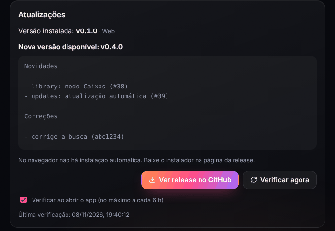

O app verifica sozinho ao abrir (no máximo a cada 6 h; dá para desligar em Ajustes) e mostra um aviso na barra lateral quando há versão nova.

**Configuração única (antes do primeiro merge).** O `auto-release` só publica quando a assinatura está configurada, para que a primeira release já possa se atualizar sozinha:

```bash
pnpm tauri signer generate -w ~/.tauri/games-gallery.key   # gera a chave privada (protegida por senha) e a pública
```

1. **Settings → Secrets and variables → Actions → Secrets:** `TAURI_SIGNING_PRIVATE_KEY` (conteúdo do arquivo `.key`) e `TAURI_SIGNING_PRIVATE_KEY_PASSWORD`.
2. **… → Variables:** `TAURI_UPDATER_PUBKEY` (conteúdo do arquivo `.key.pub`; é público).
3. Guarde a chave privada: se ela for perdida, os apps instalados não aceitam atualizações assinadas por outra chave.

A chave pública e o endereço do `latest.json` são mesclados na configuração do Tauri só no build da release (`src-tauri/tauri.updater.conf.json`, gerado pelo workflow); builds locais (`pnpm tauri build`) não têm atualização automática. No Windows e no macOS os instaladores ainda não têm certificado de código/notarização, então o sistema avisa na instalação.

## Telas

| Tela | O que mostra |
|---|---|
| Biblioteca / Instalados | grid paginado de até 60 capas, busca (sem acento), filtros por provedor, plataforma e status; ordenação, contagem do intervalo e ação para limpar filtros |
| Quero jogar | kanban com drag & drop, busca por nome/gênero e seletor de status acessível por teclado |
| Pastas | detecção automática das bibliotecas instaladas, ou escolher pasta de ROMs/Steam, revisar o que foi reconhecido (novo / vincular / já importado), ver o emulador de cada jogo e importar |
| Promoções | ofertas da Steam, GOG e Epic (BRL) e a wishlist da Steam com o preço de agora, em promoção primeiro; abre a página da loja, não compra |
| Conexões | SteamID64 + chave da Web API, chave do RAWG, interruptor do Steam Reviews, login Epic de uso único e botão **Testar** em cada fonte remota |
| Jogos grátis | jogos gratuitos da Epic Games Store (agora e em breve) e jogos do mês do PlayStation Plus, com abrir na loja, wishlist e “já resgatei” |
| Estatísticas | totais, % zerados, nota média, distribuição por status/nota/plataforma/provedor, mais jogados, backlog nunca jogado |
| Plataformas | 34 plataformas e se há emulador pronto, a instalar, ou nenhum viável (PS5, Xbox One, Series) |
| Provedores | 18 lojas/serviços: de onde cada um é lido, o que foi detectado, quando foi a última leitura e o motivo quando não dá para ler |
| Emuladores | 35 emuladores, página oficial de download e comandos de instalação (winget, Scoop, Flatpak, Homebrew) com botão copiar, script único dos que faltam, plataformas, BIOS exigida, comando de launch, instalar/remover, e os jogos da biblioteca que usam cada um (quantos estão prontos para jogar) |
| Drawer do jogo | status, nota, horas, notas pessoais, emulador escolhido, caminho da ROM e o comando exato que seria executado |

Os diálogos de adicionar jogo e detalhes do jogo usam `<dialog>` nativo: Escape fecha, o fundo fica inerte, o foco retorna ao acionador e apenas um overlay abre por vez. O formulário rola em telas baixas e empilha campos em telas estreitas.

As telas secundárias carregam quando abertas. A interface mostra o estado de carregamento e permite tentar novamente se um chunk falhar.

Em telas de até 860 px, a navegação lateral compacta para ícones com nomes acessíveis e dicas ao passar o ponteiro; os indicadores da biblioteca se reorganizam sem cortar conteúdo.

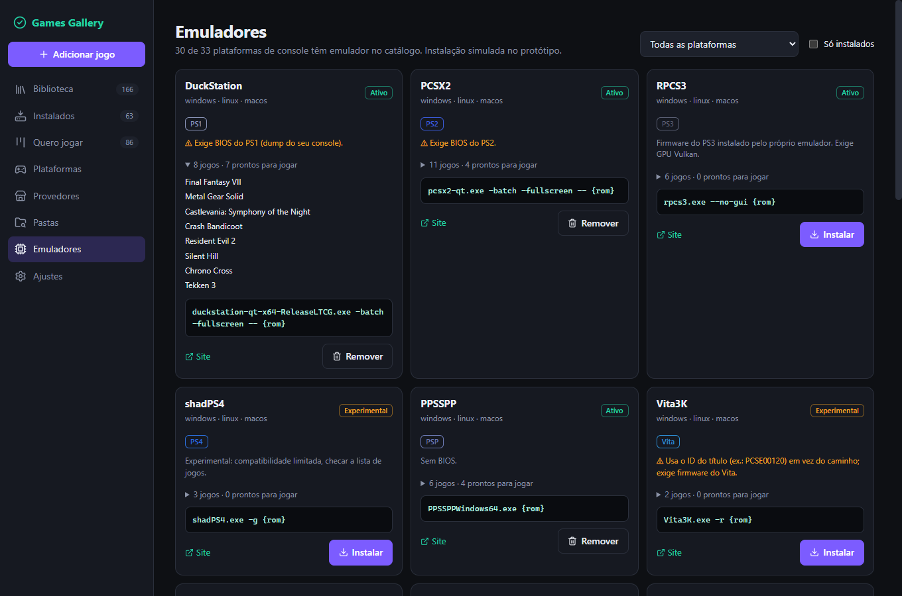

## Jogos grátis (Epic e PlayStation Plus)

- **Epic:** lê o endpoint JSON público que a própria loja usa (`freeGamesPromotions`), sem chave. Só entram ofertas 100% grátis (na resposta, `discountPercentage: 0`; um valor como 20 é só desconto). Não é uma API oficial e pode mudar.
- **PlayStation Plus:** não existe API aberta. A API REST do PlayStation Blog está desativada e o `robots.txt` bloqueia `/tag/` e `/category/`, então o app lê o feed principal (`/feed/`), uma página por vez, esperando 5 s entre elas (o `Crawl-delay` do blog), até achar o post “Monthly Games”. Só roda quando você clica em “Buscar jogos do mês” e fica em cache por 7 dias. Os nomes vêm do título do post (podem errar se um título tiver vírgula): o link do anúncio fica no card. A lista “Game Catalog” não é lida.
- **O app não resgata por você.** O resgate exige o seu login na Epic ou na PS Store; o card abre a página oficial e você marca “Já resgatei” depois.
## Instalar emuladores

Cada emulador tem a página oficial de download e, quando existe, o comando verificado de cada gerenciador (winget, Scoop, Flatpak/Flathub, Homebrew), com o do seu sistema primeiro. O botão **Copiar script dos que faltam** junta os emuladores que a sua biblioteca usa e que ainda não estão instalados.

- Os dados ficam em `src/domain/emulatorSources.ts`; cada id foi conferido (`winget show --exact`, manifest do Scoop no GitHub, API do Flathub, formulae.brew.sh) em 2026-10-22. Ids que não resolveram, ou que são de outro publicador ou do upstream arquivado, ficaram de fora: o fallback é a página oficial.
- O app **executa** a instalação depois da confirmação: comando Rust com argv-only (sem shell), saída real do gerenciador na tela e cancelamento que mata o processo. Os ids são validados antes de ir para a linha de comando.
- Plataformas de console sem emulador utilizável continuam sendo PS5, Xbox One e Series. Rejeitados na pesquisa: Yuzu e Suyu (retirados após ação da Nintendo), Citra e Lime3DS (redirecionam para o Azahar), Ryujinx original (descontinuado; o Ryubing já está no catálogo), simple64, DeSmuME, Nestopia UE, Kega Fusion e higan.
- O comando de **launch** de cada emulador segue heurístico, exceto os marcados como verificados na documentação (hoje: shadPS4, Stella e Ymir).

## Pastas e varredura

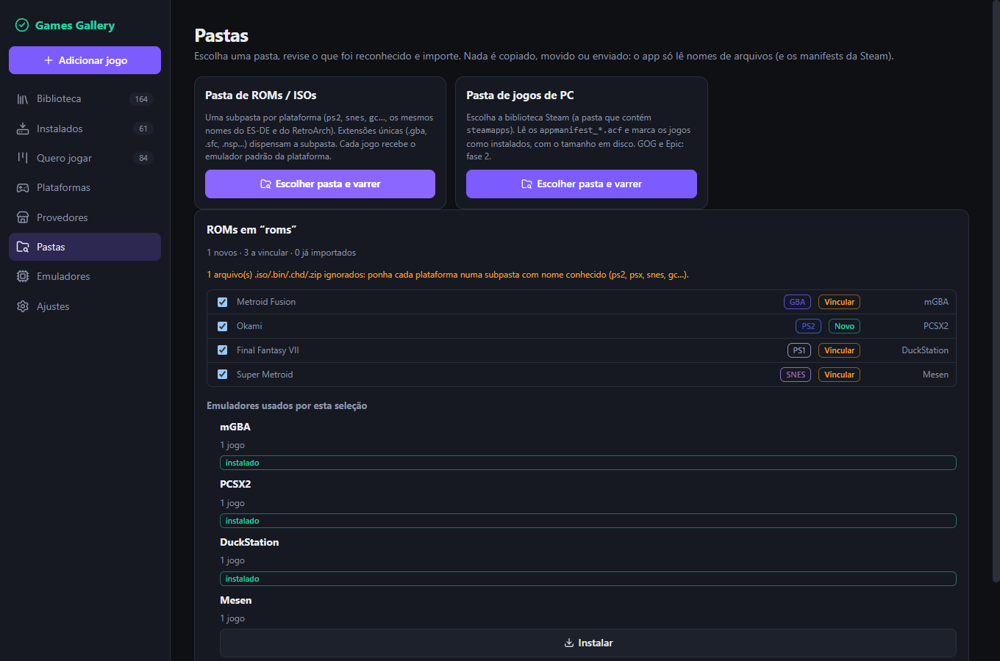

- **ROMs:** uma subpasta por plataforma, com os mesmos nomes do ES-DE/RetroArch (`ps2`, `psx`, `snes`, `gc`, “Sony - PlayStation 2”…). Extensões que identificam uma plataforma sozinhas (`.gba`, `.sfc`, `.nsp`…) dispensam a pasta; `.iso/.bin/.chd/.zip/.cso/.gcz/.md…` são compartilhadas entre sistemas e só entram com a pasta. Discos múltiplos e `.cue`+`.bin` viram um jogo só.
- **Jogos de PC:** a detecção automática lê `libraryfolders.vdf` + `appmanifest_*.acf` de todas as bibliotecas Steam, os `.item` da Epic, `galaxy-2.0.db` (só jogos GOG), `butler.db` do itch.io, o SQLite do Amazon Games e o registro de Ubisoft/Rockstar. Só com a sua chave a Steam Web API é chamada; login, tokens de loja e arquivos de credenciais dos launchers não são tocados. O registro local é tratado como declaração de instalação, e entradas Legendary com verificação pendente mostram um aviso.
- O importador Epic só abre arquivos `.item` e o arquivo chamado exatamente `installed.json` dentro da pasta escolhida; aplica limites de 1 MiB por `.item`, 8 MiB por `installed.json`, 5.000 arquivos e 64 MiB no total, informando itens omitidos. Caminhos de instalação são usados apenas para confirmar que o registro tem um valor; não são consultados no disco.
- Cada ROM é ligada a um jogo que você já tem (mesmo título, sem acento/caixa) ou vira um jogo novo; o emulador padrão da plataforma aparece em cada linha, com botão para instalar o que falta.
- A revisão dos resultados mostra 100 itens por página; é possível revisar e desmarcar qualquer resultado. A seleção e o total para importar persistem entre páginas.
- No Tauri o seletor é nativo e o caminho salvo é absoluto; o escopo de leitura vale só para a pasta escolhida e some ao fechar o app (reescanear = escolher de novo). No browser (`pnpm dev`) o caminho salvo é relativo à pasta escolhida.
- **RetroArch:** na tela Emuladores, “Exportar playlists (.lpl)” gera uma playlist por plataforma (formato JSON documentado no libretro; core e CRC ficam `DETECT`, o RetroArch pergunta o core na primeira vez).
- Pesquisa de concorrentes (Playnite, LaunchBox, Pegasus, ES-DE, RetroArch…): [docs/competitors.md](docs/competitors.md).

## Backup e restauração

Backups podem representar uma biblioteca intencionalmente vazia. Ao importar, a confirmação mostra a substituição por 0 jogos; caminhos de configuração ausentes ou inválidos são mantidos, e um caminho vazio explícito limpa essa configuração.

## Notas (sua nota + notas públicas)

Suas estrelas (1–5) viram 0–100 e são comparadas com a média pública no drawer do jogo.

| Fonte | Acesso | Estado |
|---|---|---|
| Steam Reviews (`appreviews`) | pública, sem chave | ativo (testado ao vivo) |
| RAWG (traz a nota do Metacritic + comunidade) | chave gratuita, em Ajustes | implementado; **não testado com chave real** (só o caminho de erro 401) |
| IGDB, OpenCritic | segredo Twitch / RapidAPI | fase 2: o token só pode viver no backend Rust |
| Metacritic direto | não há API pública | só via campo do RAWG |

Nenhuma dessas APIs envia CORS: em `pnpm dev` as chamadas passam por proxy do Vite (`/proxy/*`); no Tauri usam o plugin HTTP com escopo restrito a `store.steampowered.com`, `api.steampowered.com` e `api.rawg.io`. O cache é de 24h e as chaves ficam no cofre do sistema (veja Decisões de segurança).

As leituras de rede têm prazo total de 30 s, inclusive durante o consumo do corpo. Respostas JSON são limitadas a 4 MiB; RSS mantém o limite de caracteres por chamada.

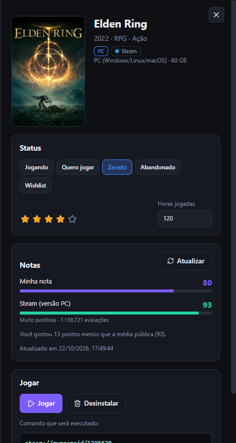

## Dados reais

Nada de biblioteca de demonstração: o app lê o que existe no computador e o que as APIs respondem.

| Fonte | Como é lido |
|---|---|
| Steam | `steamapps/libraryfolders.vdf` (todas as bibliotecas) + `appmanifest_*.acf`; runtimes e redistributables são descartados. Com SteamID64 + chave da Web API, `IPlayerService/GetOwnedGames` completa a conta e as horas jogadas |
| Epic | instalados: `*.item` em `ProgramData/Epic/EpicGamesLauncher/Data/Manifests`; Legendary e Heroic quando existem. Comprados: login Epic em Conexões |
| GOG | `galaxy-2.0.db` (SQLite, somente leitura) **só para os jogos GOG** (`gog_*`); as demais lojas conectadas no Galaxy são ignoradas de propósito. Tamanho em `DiskSizes` e instalação em `InstalledBaseProducts` |
| itch.io | `butler.db` (tabelas `caves` + `games`) |
| Amazon Games | `GameInstallInfo.sqlite`, tabela localizada pelas colunas |
| Ubisoft | instalados: `Installs\<id>\InstallDir` + `Uplay Install <id>` (nome) no registro. O cache de posse (`cache/ownership`, `configuration`) é criptografado com DPAPI e guarda chaves de CD: **nunca é aberto** |
| EA app / Origin | instalados: chaves `EA Games`/`Electronic Arts`, `Origin/LocalContent/*.mfst` e `installerdata.xml` |
| Battle.net | instalados: `ProgramData/Battle.net/Agent/product.db` (protobuf, leitor com limites) + entradas de desinstalação da Blizzard |
| Xbox app | instalados: `<unidade>:\XboxGames\*\Content\MicrosoftGame.Config` (identidade do pacote + nome de exibição) |
| Rockstar | chave `InstallFolder` no registro do Windows |
| Emuladores | cada executável do catálogo é procurado no `PATH`, WinGet Links, Scoop shims, `Program Files` e na pasta configurada em Ajustes |

- **Instalar/desinstalar jogo** abre o fluxo da própria loja (`steam://install/…`, `steam://uninstall/…`, `com.epicgames.launcher://apps/…?action=install|uninstall`). O app não baixa nem apaga arquivos de jogo.
- **Instalar/remover emulador** roda o gerenciador de pacotes de verdade (`winget`, `scoop`, `flatpak`, `brew`) com argv explícito, sem shell, e mostra a saída real linha por linha. O botão pede confirmação antes.
- **Jogar** em emulador executa o executável encontrado no disco, com `args` em array; um caminho como `a & calc.exe` continua sendo um único argumento.
- **Jogos grátis** (Epic + PS Blog) e **notas** (Steam Reviews, RAWG com chave) já eram reais e continuam.
- **Promoções:** Steam (`api/featuredcategories`), GOG (`catalog.gog.com/v1/catalog?discounted=eq:true`, que só responde com `locale=en-US`) e Epic (`freeGamesPromotions`, só descontos parciais). São endpoints não oficiais das próprias lojas e podem mudar: `pnpm smoke:live` detecta isso.
- **Wishlist da Steam:** `IWishlistService/GetWishlist` + `IStoreBrowseService/GetItems` (nome e preço em lote de 50). Perfil com “detalhes do jogo” privado devolve lista vazia, e a tela explica.
- **Jogos repetidos entre lojas:** o mesmo título PC em lojas diferentes vira um único cartão com o selo "N lojas" e a lista de lojas no rodapé. O drawer mostra "Em N lojas" (instalado, na conta, horas) e permite trocar para a cópia de cada loja para jogar ou instalar por ela; a cópia instalada vence como principal. Nada muda no que é salvo: cada loja continua sendo um registro e a unificação é feita na leitura (título normalizado; a mesma loja listada duas vezes não é unida). O filtro "Em mais de uma loja" e o painel "Repetidos entre lojas" nas Estatísticas mostram só esses jogos. Status, nota e anotações valem para todas as cópias que você tem; horas, instalação e ids continuam por loja (o drawer soma as horas). Se dois jogos diferentes tiverem o mesmo nome, "Não é o mesmo" separa a cópia e "Unificar de novo" desfaz. "Quero jogar" e a busca (Ctrl+K) também mostram um jogo só, e buscar por "epic" ou "gog" acha os jogos da loja.
- **Promoções cruzadas com a biblioteca:** cada oferta mostra em quais lojas você já tem o jogo, se ele está na wishlist (Steam ou do app) e onde o mesmo título está mais barato (só na mesma moeda). A seção "Para você" lista a wishlist em promoção que você não tem em nenhuma loja.
- **Paleta Ctrl+K:** além de telas e jogos (um resultado por título, com as lojas), ela tem as ações "Detectar bibliotecas agora" e "Mostrar jogos em mais de uma loja".
- **Densidade da grade e atalhos:** a biblioteca alterna entre capas "Confortável", "Compacta" (8 por linha, só o título) e "Caixas", e a escolha é lembrada neste computador. A tecla `?` (ou a paleta) mostra os atalhos do teclado.
- **Ofertas acabando:** promoções que terminam em até três dias ganham a etiqueta "Acaba em menos de 24 h" ou "Acaba em N dias", calculada pelo tempo restante (não depende do fuso).
- **Aviso de preço-alvo:** em qualquer oferta ou item da wishlist, "Avisar" guarda o preço que você pagaria por aquele título (em qualquer loja, na mesma moeda). Ao abrir o app, as ofertas em cache são conferidas e um aviso diz o que chegou ao alvo; a seção "Alertas de preço" e o contador em Promoções mostram o resto. Os alvos ficam só neste computador (`localStorage`), nada é enviado, e entram no backup JSON (um backup antigo sem alvos não apaga os atuais). Destaque, "Jogando agora" e o sorteio do backlog contam um jogo por título, com as horas somadas das lojas.
- **Login Epic (biblioteca comprada):** abre a página de login da Epic, você cola o código de uso único, o app troca por um token de sessão, lê `library-service` + catálogo (títulos), e **revoga o token** em seguida. Nada é guardado. Só funciona no app nativo.
- **Login Amazon Games:** mesmo desenho do Epic, seguindo o cliente aberto Nile: abre `amazon.com/ap/signin` (OpenID + PKCE S256), você cola o endereço da página para onde a Amazon te leva, o app registra um dispositivo temporário (`api.amazon.com/auth/register`), lê `GetEntitlements` e **remove o dispositivo** (`auth/deregister`). O filtro entre jogo e brinde Prime não pôde ser confirmado na fonte do Nile, então a lista inclui o que a conta tiver.
- **Login Battle.net e EA app (janela isolada):** o Rust abre uma janela sem acesso ao app e sem sessão persistente. Battle.net: após o login lê `account.battle.net/api/games-and-subs` com os cookies da janela (padrão do Playnite; sem segredo de cliente). EA: um gancho de `fetch` na janela captura o token que a própria página usa e o Rust consulta `service-aggregation-layer.juno.ea.com` com a query persistida `getPreloadedOwnedGames`, paginada. O hash da query é uma constante em `account_login.rs` e a EA o troca de tempos em tempos.
- **Login Ubisoft Connect:** segue o plugin aberto do Galaxy (`galaxy-integration-uplay`): abre `connect.ubisoft.com/login` com o `appId` do Club, espera a página `/ready`, vai a `/change_domain/` e lê o `PRODloginData` do `localStorage` (ticket e `sessionId`), registra a sessão (`POST v2/profiles/sessions`) e consulta o GraphQL `AllGames` (`public-ubiservices.ubi.com/v1/profiles/me/uplay/graphql`), filtrando jogos de PC. O ticket sai da janela uma única vez, validado, e nada é guardado. **Não foi validado com conta real**: se a Ubisoft recusar, o erro aparece, nunca uma biblioteca vazia.
- **Steam Reviews:** vem de `IStoreBrowseService` (`include_reviews`), com `appreviews` como reserva: este último passou a redirecionar para a home em alguns clientes.
- **Provedores que exigem login** (PSN, Xbox Live, Nintendo, Humble) e **Playnite** (LiteDB) aparecem como indisponíveis com o motivo, em vez de fingir uma conexão. Ubisoft, EA e Battle.net sem o login de conta mostram só os instalados.

### Limites conhecidos

- Identificação de ROM por hash (No-Intro/Redump) ainda não existe: o scan usa pasta + extensão.
- A biblioteca persiste em `localStorage`; SQLite no backend é fase 2.
- **Ubisoft Connect, o que a engenharia reversa mostrou:** `cache/ownership/*.vdat`, `cache/configuration/*.vdat` e `user.vdat` são envelopes protobuf (`{versão, id da chave de 32 hex, nonce de 12 bytes, tag de 16 bytes}` + texto cifrado, padrão de AES-GCM). A chave vem de `ConnectSecureStorage.dat`, outro protobuf cujo payload não é um blob DPAPI (`CryptUnprotectData` rejeita), então a derivação está dentro do binário do launcher. Ler isso exigiria contornar a proteção do launcher sobre um cache que também guarda chaves de CD; por isso o app não tenta e usa o login de conta.
- Comprados da Ubisoft, EA e Battle.net só aparecem pelo login de conta (Conexões); sem ele, não há fonte local legível (cache criptografado ou biblioteca só no servidor). O app **não depende do GOG Galaxy** para nenhuma loja de terceiros. Jogos instalados (ids do registro) e comprados (ids da conta) são unidos pelo título normalizado.
- Xbox app / Game Pass PC: só os instalados (`<unidade>:\XboxGames\*\Content\MicrosoftGame.Config`). Os comprados exigiriam login Microsoft (XSTS), ainda não implementado; antes vinham do Galaxy.
- As chaves (Steam Web API e RAWG) ficam no cofre do sistema (Gerenciador de Credenciais do Windows, Keychain ou Secret Service) e só são enviadas ao host da própria API. Perfis antigos que as tinham em `localStorage` são migrados e limpos no primeiro boot. No navegador (`pnpm dev`) não há cofre: a chave vale só para a sessão.

## Smoke tests

```bash
pnpm smoke         # typecheck + testes + smoke live + smoke nativo
pnpm smoke:live    # bate nos endpoints reais (Steam, GOG, Epic, Steam Reviews, wishlist) com os mesmos parsers do app
pnpm smoke:native  # lê esta máquina (Steam, Epic, GOG/Galaxy, Ubisoft, EA, Battle.net...) e sai com erro se um launcher presente não for lido
```

Na tela **Conexões**, o botão **Testar** faz a mesma verificação com as suas chaves.

## Estrutura

```
src/domain/     tipos, catálogos (platforms, providers, emulators), launch.ts, filter.ts, gameFactory.ts, detect.ts
src/state/      zustand: library (persistido), ui (navegação/filtros), tasks (jobs reais), secrets (chaves)
src/components/ Cover, GameCard, GameDrawer, LaunchPanel, FilterBar, ...
src/views/      uma view por tela
src/platform/   runtime.ts, native.ts (invoke), folders.ts, http.ts, steamApi.ts, dealsApi.ts, epicAccount.ts, probes.ts, updates.ts
scripts/release/ regras de versão e notas (lib.mjs), plan/stamp/check-title usados pelo CI
src-tauri/      detect*.rs (bibliotecas locais: Steam/Epic/GOG, ea, battlenet, ubisoft), emulators.rs (detecção/instalação/execução), plugins
```

## Decisões de segurança

- **Chaves de API no cofre do sistema:** `src-tauri/src/secrets.rs` expõe `secret_set/get/delete` só para os nomes `steamKey` e `rawgKey` (allow-list), com limite de tamanho e sem caracteres de controle. O `localStorage` guarda apenas o SteamID64 (público) e o interruptor do Steam Reviews.
- O launch de emulador é um **array de argumentos** (`args: ["-batch", "--", "{rom}"]`), nunca uma string de shell: um caminho como `a & calc.exe` vira um único argv (testes em `launch.test.ts` e `emulators.rs`).
- `storeId` é validado (`/^[\w.-]+$/`) antes de entrar em URI de loja; o Tauri só abre os esquemas da allow-list.
- Os comandos nativos validam gerenciador e pacote (`valid_token`) e exigem executável existente em caminho absoluto.
- A permissão de abertura do Tauri usa somente a lista explícita de URLs e esquemas; `opener:default` não é concedido, pois também permite URLs HTTP/HTTPS fora dessa lista.
- CSP restringe imagens a `self`, Steam CDN e libretro.
- Atualizações: só aceita release publicada, estável (`vX.Y.Z`) e com link deste repositório; o instalador só é aplicado com assinatura minisign válida, e o app só abre páginas de release deste repositório.
- O app **não baixa nem distribui BIOS, firmware, chaves ou ROMs**; o usuário fornece os dele.
- A leitura é somente leitura: `galaxy-2.0.db`, `butler.db` e `GameInstallInfo.sqlite` são abertos com `SQLITE_OPEN_READ_ONLY`.

## Fase 2 (não feito)

1. Persistência em SQLite no backend; cache local de capas; fonte de capas com chave própria (IGDB, SteamGridDB ou ScreenScraper) — o hotlink atual é só para o protótipo.
2. Identificação das ROMs por hash (CRC32/serial contra No-Intro/Redump, como o RetroArch); hoje o scan usa pasta + extensão.
3. Validar `exe`/`args` de cada emulador contra a build instalada (hoje o catálogo é heurístico e o caminho real vem da detecção).
4. Playnite (LiteDB) e validar o login da Ubisoft com uma conta real (hoje só há testes com respostas simuladas).
5. Status dos forks (Ryubing, Eden, Azahar) muda rápido: revisar o catálogo periodicamente.
