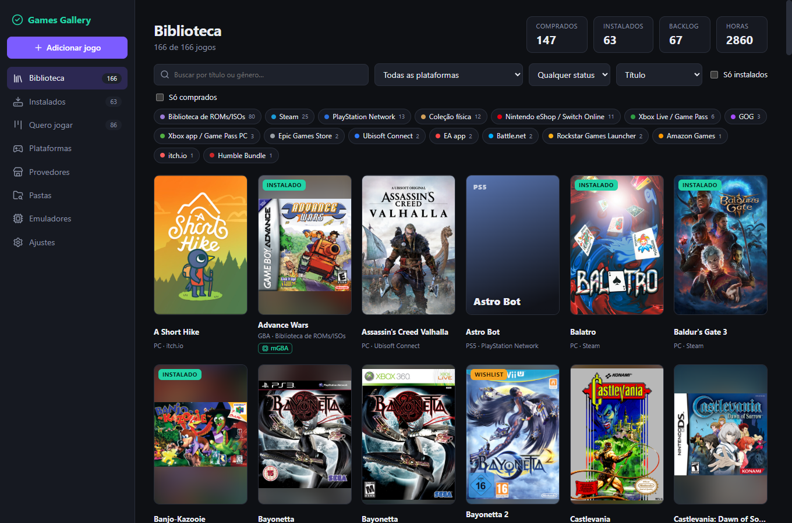
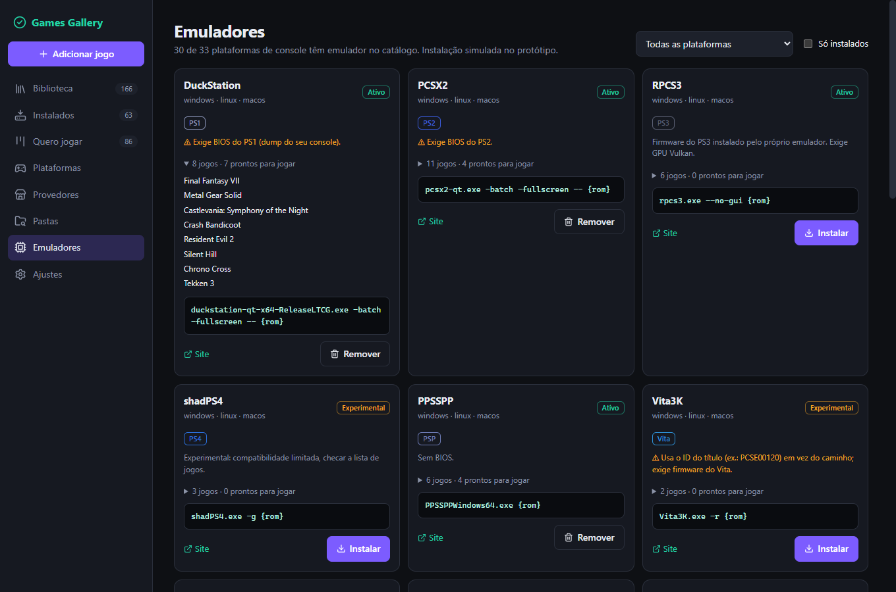
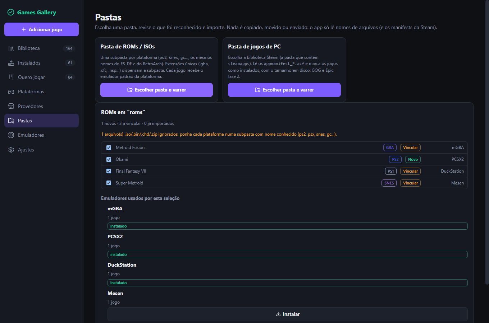
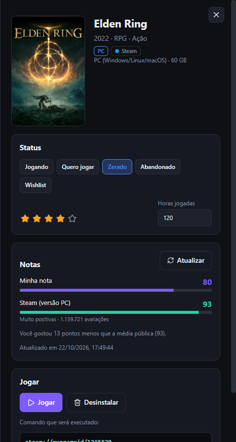

# Games Gallery

Protótipo navegável (Tauri 2 + React 19 + TypeScript + Vite) para catalogar jogos de **PC** (Steam, GOG, Epic, Ubisoft, EA, Battle.net, Game Pass, Amazon, itch.io, Humble, Rockstar, Playnite/Heroic) e de **consoles** (PS1–PS5, PSP, Vita, Xbox → Series, NES → Switch, Sega, retrô), com capas, status (jogando / quero jogar / zerado / abandonado / wishlist) e gerenciamento de **emuladores**.



## Rodar

Requisitos: Node.js 22.12+, 24.x ou 26+; pnpm 10.34.5.

O CI valida todos os workflows do GitHub Actions com actionlint antes de instalar as dependências.

```bash
pnpm install
pnpm dev            # só a UI, em http://localhost:1420
pnpm tauri dev      # janela nativa (requer Rust + WebView2)
pnpm test           # lógica de domínio
VITE_CHECK_COVERS=1 pnpm test   # também confere que todas as URLs de capa respondem
```

## Telas

| Tela | O que mostra |
|---|---|
| Biblioteca / Instalados | grid paginado de até 60 capas, busca (sem acento), filtros por provedor, plataforma e status; ordenação, contagem do intervalo e ação para limpar filtros |
| Quero jogar | kanban com drag & drop, busca por nome/gênero e seletor de status acessível por teclado |
| Pastas | escolher pasta de ROMs ou biblioteca Steam, revisar o que foi reconhecido (novo / vincular / já importado), ver o emulador de cada jogo e importar |
| Jogos grátis | jogos gratuitos da Epic Games Store (agora e em breve) e jogos do mês do PlayStation Plus, com abrir na loja, wishlist e “já resgatei” |
| Estatísticas | totais, % zerados, nota média, distribuição por status/nota/plataforma/provedor, mais jogados, backlog nunca jogado |
| Plataformas | 34 plataformas e se há emulador pronto, a instalar, ou nenhum viável (PS5, Xbox One, Series) |
| Provedores | 18 lojas/serviços: método de importação, conectar, sincronizar |
| Emuladores | 35 emuladores, página oficial de download e comandos de instalação (winget, Scoop, Flatpak, Homebrew) com botão copiar, script único dos que faltam, plataformas, BIOS exigida, comando de launch, instalar/remover, e os jogos da biblioteca que usam cada um (quantos estão prontos para jogar) |
| Drawer do jogo | status, nota, horas, notas pessoais, emulador escolhido, caminho da ROM e o comando exato que seria executado |

Os diálogos de adicionar jogo e detalhes do jogo usam `<dialog>` nativo: Escape fecha, o fundo fica inerte, o foco retorna ao acionador e apenas um overlay abre por vez. O formulário rola em telas baixas e empilha campos em telas estreitas.

As telas secundárias carregam quando abertas. A interface mostra o estado de carregamento e permite tentar novamente se um chunk falhar.

Em telas de até 860 px, a navegação lateral compacta para ícones com nomes acessíveis e dicas ao passar o ponteiro; os indicadores da biblioteca se reorganizam sem cortar conteúdo.



## Jogos grátis (Epic e PlayStation Plus)

- **Epic:** lê o endpoint JSON público que a própria loja usa (`freeGamesPromotions`), sem chave. Só entram ofertas 100% grátis (na resposta, `discountPercentage: 0`; um valor como 20 é só desconto). Não é uma API oficial e pode mudar.
- **PlayStation Plus:** não existe API aberta. A API REST do PlayStation Blog está desativada e o `robots.txt` bloqueia `/tag/` e `/category/`, então o app lê o feed principal (`/feed/`), uma página por vez, esperando 5 s entre elas (o `Crawl-delay` do blog), até achar o post “Monthly Games”. Só roda quando você clica em “Buscar jogos do mês” e fica em cache por 7 dias. Os nomes vêm do título do post (podem errar se um título tiver vírgula): o link do anúncio fica no card. A lista “Game Catalog” não é lida.
- **O app não resgata por você.** O resgate exige o seu login na Epic ou na PS Store; o card abre a página oficial e você marca “Já resgatei” depois.
## Instalar emuladores

Cada emulador tem a página oficial de download e, quando existe, o comando verificado de cada gerenciador (winget, Scoop, Flatpak/Flathub, Homebrew), com o do seu sistema primeiro. O botão **Copiar script dos que faltam** junta os emuladores que a sua biblioteca usa e que ainda não estão instalados.

- Os dados ficam em `src/domain/emulatorSources.ts`; cada id foi conferido (`winget show --exact`, manifest do Scoop no GitHub, API do Flathub, formulae.brew.sh) em 2026-10-22. Ids que não resolveram, ou que são de outro publicador ou do upstream arquivado, ficaram de fora: o fallback é a página oficial.
- O app **não executa** a instalação: ele mostra e copia o comando para você revisar e rodar. Instalação automática (comando Rust com escopo, argv-only e verificação de hash) é fase 2.
- Plataformas de console sem emulador utilizável continuam sendo PS5, Xbox One e Series. Rejeitados na pesquisa: Yuzu e Suyu (retirados após ação da Nintendo), Citra e Lime3DS (redirecionam para o Azahar), Ryujinx original (descontinuado; o Ryubing já está no catálogo), simple64, DeSmuME, Nestopia UE, Kega Fusion e higan.
- O comando de **launch** de cada emulador segue heurístico, exceto os marcados como verificados na documentação (hoje: shadPS4, Stella e Ymir).

## Pastas e varredura



- **ROMs:** uma subpasta por plataforma, com os mesmos nomes do ES-DE/RetroArch (`ps2`, `psx`, `snes`, `gc`, “Sony - PlayStation 2”…). Extensões que identificam uma plataforma sozinhas (`.gba`, `.sfc`, `.nsp`…) dispensam a pasta; `.iso/.bin/.chd/.zip/.cso/.gcz/.md…` são compartilhadas entre sistemas e só entram com a pasta. Discos múltiplos e `.cue`+`.bin` viram um jogo só.
- **Jogos de PC:** lê `appmanifest_*.acf` da biblioteca Steam e manifestos locais `.item` do Epic Games Launcher ou `installed.json` do Legendary/Heroic. Não acessa APIs, login, tokens ou arquivos de credenciais; também não executa launcher nem verifica os arquivos instalados. O registro local é tratado como declaração de instalação, e entradas Legendary com verificação pendente mostram um aviso.
- O importador Epic só abre arquivos `.item` e o arquivo chamado exatamente `installed.json` dentro da pasta escolhida; aplica limites de 1 MiB por `.item`, 8 MiB por `installed.json`, 5.000 arquivos e 64 MiB no total, informando itens omitidos. Caminhos de instalação são usados apenas para confirmar que o registro tem um valor; não são consultados no disco.
- Cada ROM é ligada a um jogo que você já tem (mesmo título, sem acento/caixa) ou vira um jogo novo; o emulador padrão da plataforma aparece em cada linha, com botão para instalar o que falta.
- A revisão dos resultados mostra 100 itens por página; é possível revisar e desmarcar qualquer resultado. A seleção e o total para importar persistem entre páginas.
- No Tauri o seletor é nativo e o caminho salvo é absoluto; o escopo de leitura vale só para a pasta escolhida e some ao fechar o app (reescanear = escolher de novo). No browser (`pnpm dev`) o caminho salvo é relativo à pasta escolhida.
- **RetroArch:** na tela Emuladores, “Exportar playlists (.lpl)” gera uma playlist por plataforma (formato JSON documentado no libretro; core e CRC ficam `DETECT`, o RetroArch pergunta o core na primeira vez).
- Pesquisa de concorrentes (Playnite, LaunchBox, Pegasus, ES-DE, RetroArch…): [docs/competitors.md](docs/competitors.md).

## Backup e restauração

Backups podem representar uma biblioteca intencionalmente vazia. Ao importar, a confirmação mostra a substituição por 0 jogos; caminhos de configuração ausentes ou inválidos são mantidos, e um caminho vazio explícito limpa essa configuração.

## Notas (sua nota + notas públicas)

Suas estrelas (1–5) viram 0–100 e são comparadas com a média pública no drawer do jogo.

| Fonte | Acesso | Estado |
|---|---|---|
| Steam Reviews (`appreviews`) | pública, sem chave | ativo (testado ao vivo) |
| RAWG (traz a nota do Metacritic + comunidade) | chave gratuita, em Ajustes | implementado; **não testado com chave real** (só o caminho de erro 401) |
| IGDB, OpenCritic | segredo Twitch / RapidAPI | fase 2: o token só pode viver no backend Rust |
| Metacritic direto | não há API pública | só via campo do RAWG |

Nenhuma dessas APIs envia CORS: em `pnpm dev` as chamadas passam por proxy do Vite (`/proxy/*`); no Tauri usam o plugin HTTP com escopo restrito a `store.steampowered.com` e `api.rawg.io`. O cache é de 24h e a chave RAWG fica só em memória.

As leituras de rede têm prazo total de 30 s, inclusive durante o consumo do corpo. Respostas JSON são limitadas a 4 MiB; RSS mantém o limite de caracteres por chamada.



## O que é real e o que é simulado

**Real:** navegação, filtros, kanban, persistência (`localStorage`), notas públicas da Steam, catálogos de plataformas/provedores/emuladores, capas (Steam CDN e [libretro-thumbnails](https://thumbnails.libretro.com), com capa gerada quando não existe), montagem do comando de launch, abertura de URIs de loja no Tauri (`steam://rungameid/…`, allow-list em `src-tauri/capabilities/default.json`).

Ao carregar os dados locais, campos inválidos e caches corrompidos são descartados; uma biblioteca vazia salva intencionalmente continua vazia.

**Simulado:** conectar/sincronizar lojas, instalar jogos e emuladores (barra de progresso), execução de emulador (o app mostra `exe + argv`, não executa).

Jobs simulados são cancelados quando a ação é desfeita (desinstalação ou desconexão) e ao restaurar/resetar a biblioteca; a tarefa cancelada não aplica alterações atrasadas.

## Estrutura

```
src/domain/     tipos, catálogos (platforms, providers, emulators), launch.ts, filter.ts, seed/
src/state/      zustand: library (persistido), ui (navegação/filtros), tasks (jobs simulados)
src/components/ Cover, GameCard, GameDrawer, LaunchPanel, FilterBar, ...
src/views/      uma view por tela
src/platform/   runtime.ts, folders.ts, http.ts: ponte browser ↔ Tauri
src-tauri/      shell Tauri 2 (plugins opener, http, dialog, fs)
```

## Decisões de segurança

- O launch de emulador é um **array de argumentos** (`args: ["-batch", "--", "{rom}"]`), nunca uma string de shell: um caminho como `a & calc.exe` vira um único argv (teste em `launch.test.ts`).
- `storeId` é validado (`/^[\w.-]+$/`) antes de entrar em URI de loja; o Tauri só abre os esquemas da allow-list.
- A permissão de abertura do Tauri usa somente a lista explícita de URLs e esquemas; `opener:default` não é concedido, pois também permite URLs HTTP/HTTPS fora dessa lista.
- CSP restringe imagens a `self`, Steam CDN e libretro.
- O app **não baixa nem distribui BIOS, firmware, chaves ou ROMs**; o usuário fornece os dele.

## Fase 2 (não feito)

1. Importação real: Steam Web API + `appmanifest_*.acf`, GOG Galaxy DB, manifests da Epic, registro do Windows.
2. Comando Rust com escopo para executar emuladores (exe resolvido pelo catálogo, argv-only, sem shell) e baixar emuladores de releases oficiais com verificação de hash.
3. Persistência em SQLite; cache local de capas; fonte de capas com chave própria (IGDB, SteamGridDB ou ScreenScraper) — o hotlink atual é só para o protótipo.
4. Identificação das ROMs por hash (CRC32/serial contra No-Intro/Redump, como o RetroArch); hoje o scan usa pasta + extensão.
5. `exe`/`args` de cada emulador são heurísticos: validar contra a build instalada antes de habilitar execução real.
6. Status dos forks (Ryubing, Eden, Azahar) muda rápido: revisar o catálogo periodicamente.
